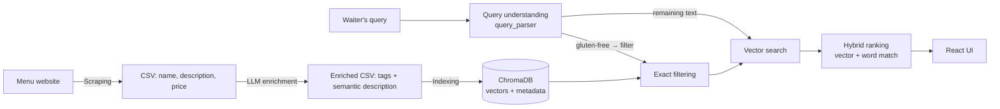

# 🍣 Smart Waiter – Natural-Language Menu Search

A waiter gets a request in plain Hebrew – *"משהו חריף עם עוף"* (something spicy with chicken),
*"סושי בלי דג נא"* (sushi without raw fish), *"מנה לילד לא חריפה"* (a non-spicy dish for a kid) –
and gets the matching dishes from the menu within a second, with price, description and allergen details.

Search combines **semantic search (vectors)**, **word matching** and **exact filtering** of attributes
such as gluten or vegan, and its quality is **measured** by an evaluation script with test queries.

| | Before | After |
|---|---|---|
| Correct dish ranked first – queries nothing was tuned on | 45% | **91%** |
| Correct dish ranked first – development queries | 47% | 100% |

---

## How it works



### 1. Data collection – `Japanika_Menu_Scraper.py`
`requests` + `BeautifulSoup` walk every `div.menuItem` on the menu page and extract name, price and description.
The selectors were found with the browser's DevTools.

### 2. Enrichment – `japanika_menu_enriched_complete.csv`
Each dish was enriched with a language model:
- **Structured tags**: spicy, gluten, dairy, raw fish, vegan, vegetarian, fried, kid-friendly, protein type and more
- **Semantic description**: free text about flavors, textures and who the dish suits

### 3. Indexing – `core/search_engine.py`
- Each dish becomes a document: **name + category + menu description + semantic description**,
  and `paraphrase-multilingual-MiniLM-L12-v2` turns it into a vector (384 numbers) that represents its meaning.
- Tags are stored as metadata, **normalized** to `כן / לא / אפשרי` (yes / no / maybe).
  In the CSV they are free text such as *"לא – ציר"* ("no – broth"); the original text is kept for display.
- Dishes with no text are skipped – an empty-text vector is "a little similar to everything" and shows up for every query.
- The index is rebuilt **automatically** when the CSV or the document format changes (file fingerprint).

### 4. Hybrid search
1. **Query understanding** (`core/query_parser.py`) detects binary attributes, including negation:
   *"סושי בלי דג נא"* (sushi without raw fish) → text `סושי` + filter `raw_fish = no`.
2. **Exact filtering** in ChromaDB by those filters (detected in the text or chosen with the sidebar buttons).
3. **Ranking**: `score = (vector similarity + 1.0 × word match) / 2`.
   The word match (`core/lexical.py`) checks whether the word – or a synonym from the menu vocabulary,
   e.g. *כיסונים* (dumplings) → *גיוזה / וונטון* (gyoza / wonton) – appears in the name, category or description.
4. **Relative cutoff**: only dishes close to the best result are shown, instead of always filling 10 slots.

### 5. Interface – `api.py` + `frontend/`
- **FastAPI** exposes `POST /api/search` and `GET /api/health`.
- **React** (Vite): search box, with/without filters, menu-style dish cards with allergen details,
  and a display of what the system "understood" from the request. Mobile-friendly, right-to-left.

---

## Key decisions and why

**Why not vectors only?** Embedding models don't understand negation: the vector for *"ללא גלוטן"* (gluten-free)
is close to the vector for *"גלוטן"* (gluten). Yes/no questions – especially allergies – need an exact answer,
not "roughly". So these attributes are pulled out of the text and turned into filters.

**Why word matching?** The small model knows few Hebrew words like *"סשימי"* (sashimi) or *"כיסונים"* (dumplings),
and a one-word query returned unrelated dishes. Combining word matching with vectors is the standard approach
in search (hybrid search). The weight (1.0) was chosen with a weight sweep (`--sweep`), not guessed.

**Why the small model?** Compared with `paraphrase-multilingual-mpnet-base-v2` (about 2.5× larger):

| Model | Dev | Holdout | Size |
|---|---|---|---|
| MiniLM-L12 (chosen) | 0.95* | 0.91 | ~450MB |
| mpnet-base | 1.00 | 0.91 | ~1.1GB |

Same result on unseen queries, so the lighter model stayed.
<br/><sub>* This comparison was run before the last word-match improvement.</sub>

---

## Measurement – `eval_search.py`

Each test query has a **rule derived from the data** that defines which dishes are correct
(e.g. *"מרק חם"* (hot soup) → every dish in the soups category), so the score is objective.

- **Development queries (19)** – the weight and the vocabulary were tuned on these.
- **Holdout queries (11)** – written *after* tuning; if the score there is similar, the improvement is real and not memorized.

| Variant | Dev hit@1 | Holdout hit@1 |
|---|---|---|
| A: semantic description only (original) | 0.47 | 0.45 |
| B: + name, category and menu description | 0.58 | 0.36 |
| **C: + query understanding, filters and hybrid ranking** | **1.00** | **0.91** |

The 1.00 on the development queries is expected – they were tuned on – so the number that matters is the holdout.

**What the holdout caught:**
- **A bug:** *"חלב קוקוס"* (coconut milk) triggered the "dairy" filter and removed every coconut dish.
  The score was 0.82 before the fix and 0.91 after.
- **Overfitting:** the word-match score is half the best-matching word + half the average.
  Using only the best-matching word scored 1.00 on dev – but dropped the holdout to 0.73, so it was rejected.

**Metrics:** `hit@1` – is the first result correct. `MRR` – mean of 1 / rank of the first correct result.
`P@5` – how many of the top 5 results are correct.

```bash
venv/Scripts/python.exe eval_search.py            # comparison table
venv/Scripts/python.exe eval_search.py --verbose  # results for every query
venv/Scripts/python.exe eval_search.py --sweep    # try different word-match weights
```

---

## Known limitations

- **Small test set** (30 queries) – enough to see a direction, not to claim accuracy to a single percent.
- **Rule-based query understanding** – covers common phrasings, but an unusual one
  (*"שלא יהיה בזה חיטה"*, "it shouldn't have wheat in it") won't be detected.
  Next step: a small language model that converts a query into filters.
- **Basic morphology** – *"מנה עיקרית"* (main dish, singular) doesn't match *"מנות עיקריות"* (main dishes, plural).
- **The tags were generated by a language model** and not verified with the kitchen –
  in a real deployment, allergen data must be verified by a person.
- **The menu is small (132 dishes)**, so every dish is ranked on every search.
  For a large menu: top-100 from the vectors + a BM25 index.

---

## Running

**Requirements:** Python 3.13, Node.js 18+

```bash
python -m venv venv
venv/Scripts/python.exe -m pip install -r requirements.txt
npm --prefix frontend install
```

Two terminals:

```bash
venv/Scripts/python.exe -m uvicorn api:app --port 8000
```

```bash
npm --prefix frontend run dev
```

Then open `http://localhost:5173`. On the first run the model is downloaded (~450MB) and the index is built automatically.

> **Windows with Smart App Control:** if you see *"An Application Control policy has blocked this file"*,
> the frontend already uses Rollup's WebAssembly build (`overrides` in `frontend/package.json`) to work around it.

---

## Project structure

```
Japanika_Menu_Scraper.py              scrapes the menu from the website
japanika_menu_enriched_complete.csv   the enriched menu (132 dishes)
core/
  search_engine.py                    indexing, tag normalization, hybrid search
  query_parser.py                     detects attributes and negation in the text
  lexical.py                          word matching + menu vocabulary
api.py                                FastAPI
frontend/                             React + Vite
eval_search.py                        search quality measurement
main.py                               Streamlit UI (the first version, still works)
```
